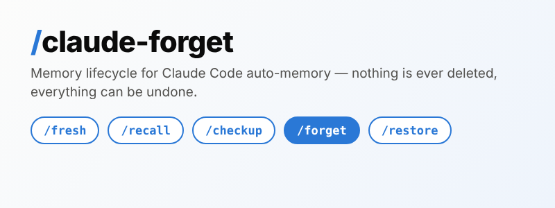

# claude-forget



Memory lifecycle for Claude Code auto-memory: /forget buries what you discard, /checkup finds what went stale, /fresh works memory-free, /recall loads the minimum back, and /restore undoes any of it.

![Diagram of the memory lifecycle. Five stages in order: /fresh starts at zero with a memory quarantine; /recall pulls the minimum back, read-only, opening exactly one topic file; /checkup reviews past-due review-after stamps, stale status notes and the health of the MEMORY.md index; /forget retires finished work by moving files to .trash with a restore manifest; /restore undoes one /forget or /checkup entry from that manifest. Footer: every step is reversible — no memory file is ever deleted, every cut line is copied verbatim into .trash/TRASH.md before the cut.](assets/lifecycle.png)

## Which door when?

| You want to... | Run | Writes anything? |
|---|---|---|
| Work on a task as if the project had no memory | `/fresh [task]` | No |
| Look up one thing from memory, nothing more | `/recall <item>` | No |
| Find notes that went stale, fix the index | `/checkup [topic]` | Yes, with one confirm, all undoable |
| Retire a discarded effort | `/forget <concern>` | Yes, with one confirm, all undoable |
| Undo a /forget or /checkup run | `/restore [entry]` | Yes, from the manifest only |

Add `--agent <name>` (or `--agents` for /checkup and /recall) to work on a
subagent's memory folder instead of the project's.

## Skills

### /forget <concern>

![Diagram: how /forget stays reversible, in five steps. 1: find the memories about the concern via index scan, keyword grep, and semantic judgment. 2: show the list — one confirm. 3: bury, don't delete — whole-match files move to memory/.trash/ and are renamed name.md to name.md.trashed; partial matches lose only the matching lines. 4: record everything in the .trash/TRASH.md manifest with a restore recipe. 5: re-index MEMORY.md and clean dangling links. Footer: restore = run /restore and pick the entry; by hand, move the file back, drop the .trashed suffix, paste the manifest's verbatim block back.](assets/forget-flow.png)

Force-forget a discarded effort, reversibly. It:

1. Finds the current project's auto-memories about the concern (index scan +
   keyword grep + semantic judgment).
2. Shows you the list — one confirm.
3. Moves whole-match files to `memory/.trash/` and renames them
   `name.md -> name.md.trashed`; partial-match files get only the matching
   lines removed.
4. Records everything in `.trash/TRASH.md` (with a restore recipe) and keeps
   `.trash/` listed in `memory/.claudeignore`.
5. Re-indexes `MEMORY.md` and cleans dangling `[[links]]`.

No memory file is ever deleted. Any text cut from a file that stays behind is
copied verbatim into `.trash/TRASH.md` before the cut, with a line anchor
(`at line N`) that says where it came from. Restore = `/restore` (below), or
by hand: move the file back, drop the `.trashed` suffix, and paste the
manifest's verbatim block back at its anchor.

Note on the mechanism: only `MEMORY.md` auto-loads each session, and topic
files are read on demand. The `.md.trashed` rename is what guarantees trashed
memories stay out of future sessions; the `.claudeignore` entry is
documentation of intent, not the enforcement.

### /checkup [topic]

Find status memories that went stale, and fix them with one confirm. It:

1. Sweeps the current project's auto-memories two ways: files whose
   `review-after: YYYY-MM-DD` stamp is past, and unstamped notes that read
   like a current status (open bugs, checkpoints, in-progress work).
2. Shows one table; you pick per file: REFRESH (you state what is true now),
   HISTORICAL (one banner line marks it as a record of the past), STAMP (add
   a review date), FORGET (handed off to /forget), or SKIP.
3. Copies every line it replaces verbatim into `.trash/TRASH.md` before the
   edit, and records every line it adds — the same manifest /forget uses.
   Nothing is ever lost, and every checkup can be undone with /restore.
4. Reports index health first: `MEMORY.md` size against Claude Code's load
   limit (the first 200 lines or 25 KB; anything after that never loads),
   orphan topic files with no index line, and dangling index lines whose
   file is gone. Dangling lines (and, if you choose, lines of files marked
   historical) can be removed with the TRIM action; each removed line goes
   into the manifest with its line anchor, so TRIM is undoable too.

The stamp convention: a perishable memory carries a top-level frontmatter
line `review-after: YYYY-MM-DD`. Facts, lessons, and references never need
one.

### /restore [entry]

Undo one /forget or /checkup run from the manifest alone. It:

1. Reads `.trash/TRASH.md` and lists the open entries, newest first. An
   entry is blocked while a newer entry touches the same file.
2. Shows a dry run for the entry you pick: added lines to delete, verbatim
   blocks to paste at their anchors, files to move back, index lines to
   re-add. One confirm.
3. Applies it, then writes `RESTORED <date>` under the entry heading. The
   entry itself is never removed, so the manifest stays a full history.

Manifests written before anchors existed (format 1) still work: the skill
asks you where each block goes before the gate.

### The freshness hook

The plugin ships a SessionStart hook. At the start of each session (and again
after a `/compact` or a fork) it checks the current project's memory folder
for `review-after` stamps that are past due and, only then, prints a short
warning. That warning also lands in the agent's context, so the agent itself
stops trusting the stale note. No stale stamps means no output at all. The
hook never edits or blocks anything, and it stays silent in projects that
have no memory folder.

How the hook finds the memory folder (first hit wins), matching how Claude
Code itself resolves it:

1. `autoMemoryDirectory` from settings: managed settings, then
   `.claude/settings.local.json`, `.claude/settings.json`, then the user
   `settings.json` in the config dir.
2. `<config dir>/projects/<CLAUDE_CODE_PROJECT_DIR_NAME>/memory`, when that
   variable is set beside `CLAUDE_CONFIG_DIR`.
3. `<config dir>/projects/<slug of the git repository root>/memory`. All
   worktrees and subfolders of one repo share one memory folder.
4. `<config dir>/projects/<slug of the launch folder>/memory` (older layout).

`<config dir>` is `CLAUDE_CONFIG_DIR`, else `~/.claude`. A folder named by a
setting or the name override is final: if it does not exist yet, the hook is
silent. If Claude Code ever changes its folder naming again, the hook finds
nothing and stays silent; /checkup itself still works. The hook runs under
bash (Git Bash on Windows, which Claude Code needs anyway).

A note on the index: Claude Code loads only the first 200 lines or 25 KB of
`MEMORY.md` at session start. Entries past that point never load. Keep the
index to one line per memory; /checkup reports the size and offers TRIM.

### /fresh — work memory-free

`/fresh [task]` puts the current session under memory quarantine: the agent
commits to acting as if the project had no auto-memory — no citing it, no
reading or writing memory files, and every subagent dispatched carries the
same instruction.

Honesty note: this is instruction-level isolation. Memory text already loaded
into the session's context is not removed; the agent commits to not using it.
For hard isolation Claude Code offers official off-switches (the
`autoMemoryEnabled` setting, the `CLAUDE_CODE_DISABLE_AUTO_MEMORY` environment
variable, and the in-session `/memory` toggle) — manual alternatives, not
part of this skill.

Two doors back: `/recall <item>` (below) loads one named topic read-only, or
say "end fresh mode" to lift the quarantine entirely.

### /recall — load the minimum back

`/recall <item>` is the read-only pull: it lists matching memory index
entries first (with word counts, and a STALE tag when a file is past its
`review-after` date), then opens exactly ONE topic file you name. It never
writes, moves, or deletes anything.

Together the skills cover the memory lifecycle (for the project folder and,
with `--agent`, for each subagent's folder): `/fresh` starts at zero,
`/recall` pulls the minimum back, `/checkup` reviews what has gone stale,
`/forget` retires what is finished, and `/restore` undoes either of the last
two.

### Subagent memory

Subagents can keep their own memory (`memory: project | local | user` in the
agent file), stored as a `MEMORY.md` plus topic files in
`.claude/agent-memory/<name>/`, `.claude/agent-memory-local/<name>/`, or
`~/.claude/agent-memory/<name>/`. The same tools work there:

- `/forget --agent <name> <concern>`, `/checkup --agent <name> [topic]`,
  `/recall --agent <name> <item>`, `/restore --agent <name> [entry]` select
  that agent's folder instead of the project folder. Each agent folder keeps
  its own `.trash/` and manifest.
- `/checkup --agents` and `/recall --agents` cover the project folder plus
  every agent folder found; rows are prefixed `agent:<name>/`.
- The freshness hook scans agent folders too and lists overdue files as
  `<name> (agent): file`.
- Project-scope folders usually live in git. The tools do not avoid them:
  if your agent memory is tracked, those files are the memory and editing
  them is the only way to fix them. The gate says "inside the repository:
  changes will show in git status" so you can decide with that in mind.
- `/fresh` cannot quarantine a subagent's own memory; it is loaded inside the
  subagent. The dispatch line asks the subagent to disregard it, which is
  instruction-level, like the rest of fresh mode.

## What it does NOT cover

- CLAUDE.md / CLAUDE.local.md instruction files
- MCP memory stores (for example `.swarm/memory.db`)
- Session transcripts
- claude.ai web memory

## Install

```
/plugin marketplace add hadeelsharaf/claude-forget
/plugin install memory-tools@claude-forget
```

The same commands work from a terminal: `claude plugin marketplace add ...`
and `claude plugin install ...`.

Already installed? A second install fails with "is already installed
globally". That is expected — the plugin is on your machine. To get the
latest version instead:

```
claude plugin marketplace update claude-forget
claude plugin update memory-tools@claude-forget
```

(restart Claude Code to apply). To remove it:
`claude plugin uninstall memory-tools@claude-forget`.

For local testing from a clone:

```
/plugin marketplace add D:\path\to\claude-forget
/plugin install memory-tools@claude-forget
```

## Testing

See `tests/TESTING.md` for the fixture round-trip procedures (forget,
checkup, restore, subagent memory, fresh, recall, and the scripted hook test
`tests/run-hook-test.sh`). GitHub Actions runs the hook test, the scanner
test (`tests/run-scan-test.sh`) and `claude plugin validate . --strict` on
every push. A local eval suite lives
in `evals/` (see `evals/README.md`): three read-only gate cases and two apply
cases for `claude plugin eval`. Evals are run locally only.

Editing skills: /forget, /restore and /checkup are generated from
`src/skills/` and `src/shared/` (text they share). Edit there, then run
`sh scripts/build-skills.sh`. The deterministic checks (stamps, index
health) live in `scripts/memory-scan`, used by both the hook and /checkup.

See `CHANGELOG.md` for what changed in each version, and `ROADMAP.md` for
what is planned next (v0.4.0: /restore, index health in /checkup, subagent
memory folders).
